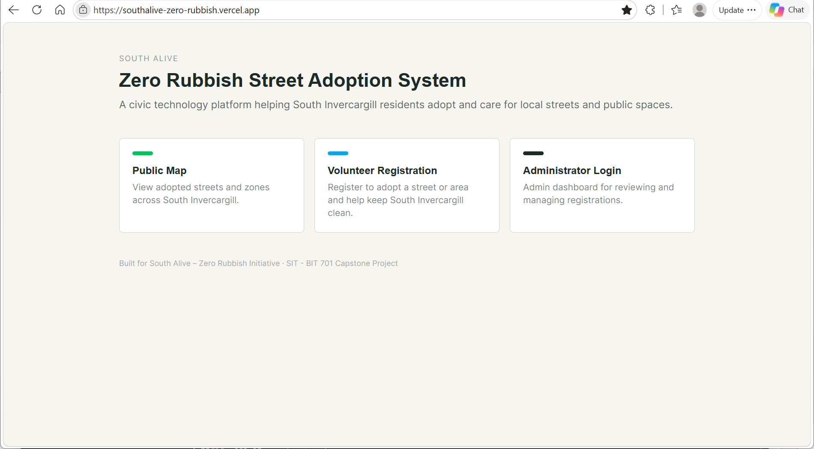

# SouthAlive Zero Rubbish

A volunteer management system with a live map for **SouthAlive's Zero Rubbish** street-adoption programme. Community volunteers sign up to adopt a street or zone and keep it litter-free. Administrators review the sign-ups, approve them, and track adoptions over time.

> Capstone project, Southern Institute of Technology.



## Live deployment

| Part | Where it runs | URL |
|------|---------------|-----|
| Frontend (public pages + admin dashboard) | Vercel | https://southalive-zero-rubbish.vercel.app |
| Admin login | Vercel | https://southalive-zero-rubbish.vercel.app/admin/login |
| Backend API | Render (Docker) | https://southalive-zero-rubbish.onrender.com |
| API health check | Render | https://southalive-zero-rubbish.onrender.com/health |


## Features

### Public (embedded on the SouthAlive website)
- **Live adoption map** (`/map`) shows every adopted street and zone. Volunteers can choose whether their name appears on the map.
- **Adopt-a-street form** (`/adopt`): volunteers register, search for an address (with autocomplete), or draw the street or zone they want on the map.

### Admin dashboard (`/admin`)
- JWT-based login with `Admin` and `SuperAdmin` roles, and self-service password change.
- Review **pending volunteers**, then approve them (assigning or drawing their area) or reject them.
- Edit or delete volunteers, and export the volunteer list to an **Excel spreadsheet**.
- Manage adopted **streets and zones**: view active and ended adoptions, record yearly updates and notes, and end an adoption.
- Additional admin accounts can be created through the API (`POST /api/auth/register`, e.g. via Swagger UI). There is no dashboard page for this yet.

### Email notifications (via [Resend](https://resend.com))
- Admins receive an alert when someone registers. Multiple comma-separated recipients are supported.
- Volunteers receive a "registration received" email, then a confirmation once they are approved.

## Tech stack

| Layer | Technology |
|-------|------------|
| Frontend | React 19, Vite, React Router, Tailwind CSS, Leaflet + Leaflet.draw (react-leaflet), Axios |
| Backend | ASP.NET Core Web API (.NET 10), Entity Framework Core |
| Database | PostgreSQL + PostGIS (geometry via NetTopologySuite) |
| Auth | JWT bearer tokens, BCrypt password hashing |
| Other | ClosedXML (Excel export), Resend (email), Swagger UI |
| Hosting | Frontend on Vercel, API on Render (Docker) |

## Repository structure

```
southalive-project/
├── SouthAlive/AdminApi/        # ASP.NET Core Web API
│   ├── Controllers/            # Auth, Public, VolunteerAdmin, AreaAdmin, Admin
│   ├── Data/                   # EF Core DbContext
│   ├── DTOs/
│   ├── Migrations/             # EF Core migrations (PostGIS schema)
│   ├── Models/                 # Admin, Volunteer, Area, Adoption, AdoptionUpdate
│   ├── Services/               # JWT token + Resend email services
│   └── Dockerfile
└── zero-rubbish-frontend/      # React + Vite single-page app
    ├── src/pages/              # Home, EmbedMap, EmbedAdopt, admin views
    ├── src/components/         # Layout, modals, Leaflet draw tools, ProtectedRoute
    ├── src/context/            # AuthContext
    ├── src/services/           # API client + config
    └── vercel.json             # SPA rewrites + iframe (frame-ancestors) policy
```

## Getting started

### Prerequisites

Install these before you start:

| Tool | Why it's needed |
|------|-----------------|
| [.NET 10 SDK](https://dotnet.microsoft.com/download) | Runs the backend API |
| [Node.js](https://nodejs.org/) 20+ and npm | Runs the React frontend |
| [PostgreSQL](https://www.postgresql.org/download/) **with the PostGIS extension** | The database. Plain PostgreSQL isn't enough, because the migrations enable PostGIS to store the street and zone shapes |
| EF Core CLI: `dotnet tool install --global dotnet-ef` | Creates the database tables from the migrations |

**Installing PostGIS:**
- **Windows:** after installing PostgreSQL, open **Stack Builder** (it comes with the installer). Under *Spatial Extensions*, pick **PostGIS**.
- **Docker (alternative):** run PostgreSQL with PostGIS already included, with nothing else to install:
  ```bash
  docker run --name southalive-db -e POSTGRES_PASSWORD=postgres -p 5432:5432 -d postgis/postgis
  ```

You don't need a Resend account to run the project locally. Without an email API key, emails are skipped and a warning is logged, and everything else works.

### 1. Configure the API

`appsettings.json` ships with empty secrets. For local development, set them with [user secrets](https://learn.microsoft.com/aspnet/core/security/app-secrets) so they stay out of the repo:

```bash
cd SouthAlive/AdminApi

dotnet user-secrets set "ConnectionStrings:DefaultConnection" "Host=localhost;Database=southalive;Username=postgres;Password=yourpassword"
dotnet user-secrets set "Jwt:Key" "a-long-random-secret-at-least-32-characters"

# Optional: email notifications
dotnet user-secrets set "Email:ResendApiKey" "re_xxxxxxxx"
dotnet user-secrets set "Email:AdminAlertAddress" "admin1@example.com,admin2@example.com"
dotnet user-secrets set "Email:AdminDashboardUrl" "http://localhost:5173/admin/login"
dotnet user-secrets set "Resend:ReplyTo" "info@example.com"
```

| Setting | Purpose |
|---------|---------|
| `ConnectionStrings:DefaultConnection` | PostgreSQL connection string (required) |
| `Jwt:Key` | Signing key for JWTs (required) |
| `Jwt:Issuer` / `Jwt:Audience` / `Jwt:ExpiryMinutes` | Token settings (defaults in `appsettings.json`) |
| `AllowedOrigins` | Comma-separated CORS origins. Defaults to the local Vite dev server |
| `Email:ResendApiKey` | Resend API key |
| `Email:AdminAlertAddress` | Comma-separated admin alert recipients |
| `Email:AdminDashboardUrl` | Login link included in admin alert emails |
| `Resend:FromAddress` / `Resend:ReplyTo` | Sender and reply-to addresses |

### 2. Create the database and run the API

```bash
cd SouthAlive/AdminApi
dotnet ef database update   # applies migrations and enables PostGIS
dotnet run
```

The API runs at `http://localhost:5166`. In Development, Swagger UI is available at `http://localhost:5166/swagger`. Use **Authorize** to paste a token from `POST /api/auth/login`.

### 3. Create the first admin account

A new database has no admin accounts, and the register endpoint requires an admin login. So the first account has to be added directly to the database:

1. **Generate a BCrypt hash of your password.** Use any BCrypt generator, or Python:
   ```bash
   pip install bcrypt
   python -c "import bcrypt; print(bcrypt.hashpw(b'YourPassword123', bcrypt.gensalt()).decode())"
   ```
2. **Insert the admin**, using pgAdmin or `psql`:
   ```sql
   INSERT INTO "Admins" ("Username", "Email", "PasswordHash", "Role")
   VALUES ('admin', 'admin@example.com', '<paste the hash here>', 'SuperAdmin');
   ```
3. Log in at `http://localhost:5173/admin/login` once the frontend is running (next step).

After that, create other admin accounts with `POST /api/auth/register` in Swagger UI.

### 4. Run the frontend

```bash
cd zero-rubbish-frontend
npm install
npm run dev
```

The app runs at `http://localhost:5173`. The API URL comes from `VITE_API_BASE_URL` in `.env.development` (default `http://localhost:5166`). Give the origin only, without `/api` or a trailing slash.

| Route | Page |
|-------|------|
| `/` | Home |
| `/map` | Embeddable live adoption map |
| `/adopt` | Embeddable volunteer registration form |
| `/admin/login` | Admin login |
| `/admin/dashboard`, `/admin/volunteers`, `/admin/streets`, `/admin/change-password` | Admin pages (login required) |

## API overview

| Method | Endpoint | Auth |
|--------|----------|------|
| `POST` | `/api/auth/login` | Public |
| `POST` | `/api/auth/register` | Admin / SuperAdmin |
| `PUT` | `/api/auth/change-password` | Logged in |
| `GET` | `/api/public/areas` | Public |
| `POST` | `/api/public/volunteers/register` | Public |
| `GET` | `/api/admin/volunteeradmin` | Logged in |
| `GET` | `/api/admin/volunteeradmin/export` | Logged in |
| `PATCH` | `/api/admin/volunteeradmin/{id}/approve` · `/reject` | Logged in |
| `PATCH` / `DELETE` | `/api/admin/volunteeradmin/{id}` (`/force` to delete with adoptions) | Logged in |
| `GET` | `/api/admin/areas` · `/api/admin/areas/ended` | Logged in |
| `GET` / `POST` | `/api/admin/areas/{areaId}/updates` | Logged in |
| `PATCH` | `/api/admin/areas/{id}/end-adoption` | Logged in |
| `GET` | `/health` · `/health/db` | Public |

## Deployment

The live system runs entirely on **free plans**. See [Live deployment](#live-deployment) for the current URLs.

```
Browser / SouthAlive WordPress iframe
            │
            ▼
  Vercel (React frontend) ──HTTPS──▶ Render (ASP.NET Core API, Docker) ──▶ Supabase (PostgreSQL + PostGIS)
                                              │
                                              └──▶ Resend (email notifications)
```

### Hosting overview

| Part | Provider | Plan | How it's deployed |
|------|----------|------|-------------------|
| Frontend | Vercel | Hobby (free) | Builds `zero-rubbish-frontend/` with `npm run build` and serves it as a static single-page app |
| Backend API | Render | Free web service | Builds a Docker image from `SouthAlive/AdminApi/Dockerfile` |
| Database | Supabase | Free | Managed PostgreSQL with the PostGIS extension |

### Free plan limits

These limits were checked in November 2026. Providers change their free plans, so confirm the current terms on their pricing pages.

**Render (API): Free web service**
- **Sleeps after 15 minutes without traffic.** The next request wakes it, which takes **about a minute**. In practice, the first person to open the map or log in after a quiet period sees a slow load. After that the API responds normally.
- **750 free instance hours per month**, shared across all free services in the Render workspace. That's enough for one service to run all month. If the hours run out, free services are suspended until the next month.
- Monthly outbound bandwidth and build minutes are capped. Without a payment method on file, going over suspends the service for the rest of the month.

**Supabase (database): Free plan**
- **500 MB database size** per project, with up to 2 active projects. This system stores mostly text and street or zone shapes, so it uses a small fraction of that.
- **Pauses after about a week of low activity.** Supabase emails a warning before pausing. A paused project keeps all its data and can be restored from the Supabase dashboard, but the API can't reach the database until it is restored. Regular use of the site keeps it active.
- Fixed 2 GB disk. The database becomes read-only if disk usage reaches 95%.
- No automatic backups you can download on the free plan. Export the data from time to time (for example with the volunteer Excel export or `pg_dump`).

**Vercel (frontend): Hobby plan**
- **100 GB bandwidth per month.** That's plenty for this site.
- Usage is **hard-capped**. Going over pauses the affected feature until the 30-day window resets, with no option to pay for more on Hobby.
- **Hobby is for personal, non-commercial use only.** For long-term use by an organisation, Vercel's terms point to the Pro plan.

### Upgrading

For a smoother experience after handover, the most useful upgrade is a **paid Render instance**. It removes the 15-minute sleep and the one-minute wake-up delay. Supabase Pro adds daily backups and removes pausing. Vercel Pro is needed if the deployment counts as commercial use.

### Deploying your own copy

1. **Database (Supabase):** create a project, then copy its connection string from **Connect** in the Supabase dashboard. Use the **Session pooler** string, because Render can't reach Supabase's IPv6-only direct connection. From your computer, run `dotnet ef database update` with that connection string. This creates the tables and enables PostGIS. Then create the first admin as described in [step 3](#3-create-the-first-admin-account).
2. **API (Render):** create a **Web Service** from this GitHub repo, with root directory `SouthAlive/AdminApi` and runtime **Docker**. The container listens on port `10000`. Add these environment variables (`__` replaces `:` from `appsettings.json`):

   | Variable | Value |
   |----------|-------|
   | `ConnectionStrings__DefaultConnection` | Supabase pooler connection string |
   | `Jwt__Key` | Long random secret |
   | `AllowedOrigins` | `https://southalive-zero-rubbish.vercel.app` (comma-separate several) |
   | `Email__ResendApiKey`, `Email__AdminAlertAddress`, `Email__AdminDashboardUrl`, `Resend__FromAddress`, `Resend__ReplyTo` | Email settings (optional) |

   Set Render's **Health Check Path** to `/health`. The API trusts Render's forwarded headers, so HTTPS works behind Render's proxy.
3. **Frontend (Vercel):** import the repo, set the root directory to `zero-rubbish-frontend` (Vite is detected automatically), and add the environment variable `VITE_API_BASE_URL=https://southalive-zero-rubbish.onrender.com`, which is the API origin with no `/api`. `vercel.json` handles routing for the single-page app. It also lets only the SouthAlive sites embed the public pages, and stops the admin pages from being embedded anywhere.

Pushing to `main` redeploys both Vercel and Render automatically, if auto-deploy is on (the default).
